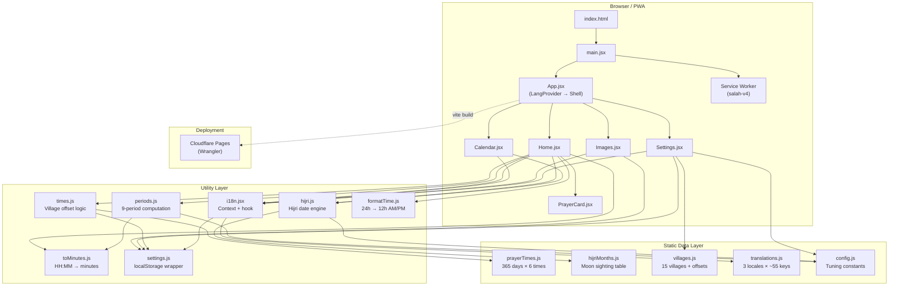
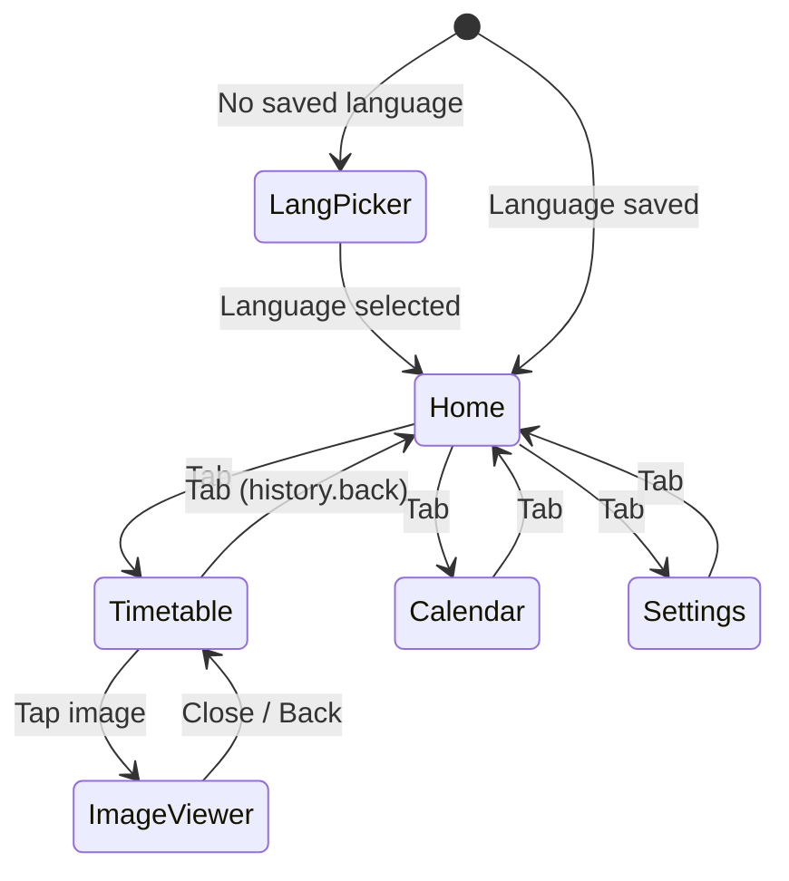

# Salah-Timing — Project Requirement Document

> **Version:** 1.0  
> **Date:** 2026-11-09  
> **Status:** As-Built Reference

---

## 1. Project Overview

**Salah-Timing** is a lightweight, offline-ready Progressive Web App (PWA) that displays daily Islamic prayer times, prohibited prayer periods, Hijri (Islamic calendar) dates, and monthly timetable images for Osmanabad (Dharashiv) district, Maharashtra, India. The app supports English, Hindi, and Urdu (with full RTL layout) and is deployable to Cloudflare Pages.

### 1.1 Goals

| # | Goal | Priority |
|---|------|----------|
| G1 | Provide accurate daily prayer times for all villages/towns of Osmanabad district | Critical |
| G2 | Show prohibited prayer periods (sunrise, zawal, sunset) with danger warnings | Critical |
| G3 | Display Hijri dates based on local moon sighting data with algorithmic fallback | High |
| G4 | Work fully offline after first visit | High |
| G5 | Support English, Hindi, and Urdu (RTL) with first-launch language picker | High |
| G6 | Provide monthly timetable images with pinch-zoom viewer and PDF downloads | Medium |
| G7 | Offer a Gregorian–Hijri dual calendar view with month navigation | Medium |
| G8 | Allow theme customization (4 color themes) | Low |

### 1.2 Target Users

- Muslim residents of Osmanabad (Dharashiv) district who need accurate local prayer timings.
- Users across Android, iOS, and desktop browsers — primarily mobile.

### 1.3 Non-Goals

- Real-time GPS-based prayer calculation (times are pre-computed for the district).
- Adhan (prayer call) audio notifications.
- User accounts or cloud sync.
- App store distribution (PWA only).

---

## 2. System Architecture



### 2.1 Technology Stack

| Layer | Technology | Version |
|-------|-----------|---------|
| UI Framework | React | 19.3.x |
| Icons | lucide-react | 1.66.x |
| Build Tool | Vite | 8.3.x |
| Language | JavaScript (ES Modules) | ES2022+ |
| Styling | Plain CSS (custom properties, no preprocessor) | — |
| Linting | ESLint (flat config) | 10.x |
| PWA | Custom Service Worker | — |
| Hosting | Cloudflare Pages (Wrangler) | 4.x |
| Offline | Cache API (network-first + stale-while-revalidate) | — |

### 2.2 Project Structure

```
├── index.html                  # Vite entry HTML
├── package.json                # Dependencies & scripts
├── vite.config.js              # Vite + React plugin
├── wrangler.jsonc              # Cloudflare Pages config
├── eslint.config.js            # ESLint flat config
├── public/
│   ├── sw.js                   # Service worker (salah-v4)
│   ├── manifest.json           # PWA manifest
│   ├── icons/                  # App icons (192, 512, maskable, apple-touch)
│   └── timetable/
│       ├── en/ hi/ ur/         # Monthly timetable images (1–12.jpg per lang)
│       └── namaz-waqt-{en,hi,ur}.pdf  # Downloadable PDF timetables
└── src/
    ├── main.jsx                # Entry point, SW registration, pre-caching
    ├── App.jsx                 # Root component, language gate, tab navigation
    ├── index.css               # All styles, 4 themes, animations
    ├── pages/
    │   └── Home.jsx            # Main prayer times dashboard
    ├── components/
    │   ├── PrayerCard.jsx      # Individual prayer time card
    │   ├── Calendar.jsx        # Gregorian–Hijri calendar grid
    │   ├── Images.jsx          # Timetable image viewer with pan-zoom
    │   └── Settings.jsx        # Language, village, theme settings
    ├── utils/
    │   ├── hijri.js            # Hijri date calculation engine
    │   ├── i18n.jsx            # Internationalization context & hook
    │   ├── formatTime.js       # 24h → 12h AM/PM formatter (with bidi isolates)
    │   ├── toMinutes.js        # "HH:MM" → minutes-since-midnight
    │   ├── periods.js          # Prayer period & prohibited period builder
    │   ├── times.js            # Village offset applicator
    │   └── settings.js         # localStorage read/write with in-memory fallback
    └── data/
        ├── prayerTimes.js      # 365-day prayer time table (array-based)
        ├── hijriMonths.js      # Moon sighting → Hijri month start dates
        ├── villages.js         # 15 villages with minute offsets
        ├── translations.js     # en/hi/ur translation strings (~55 keys each)
        └── config.js           # Tuning constants
```

---

## 3. Functional Requirements

### 3.1 First-Launch Experience

#### FR-00: Language Gate
- On first visit (no saved language), the app shows a full-screen language picker instead of the main interface.
- Three buttons: **English**, **हिन्दी**, **اردو**.
- Selecting a language saves it to localStorage and reveals the main app.
- Subsequent visits skip this screen.

### 3.2 Home Screen — Daily Prayer Times

#### FR-01: Real-Time Clock
- Display the current time in 12-hour format (h:MM AM/PM), updated every second.
- Time values are wrapped in Unicode bidi isolates (`U+2066`…`U+2069`) to force LTR rendering inside RTL context.

#### FR-02: Prayer Time Display
- Show 6 prayer times for the selected date: **Fajr, Sunrise, Zuhr, Asr, Maghrib, Isha**.
- On Fridays, the Zuhr label changes to **Jumuah (Zuhr)**.
- Each prayer card displays: icon, translated name, time in 12h format.
- Visual states per card:

| State | CSS Class | Appearance |
|-------|-----------|------------|
| **Current** | `.prayer-card.current` | Primary color background, "current" tag |
| **Next** | `.prayer-card.next` | Subtle accent highlight, "upcoming" tag |
| **Past** | `.prayer-card.past` | Reduced opacity (0.5) |

#### FR-03: Current Period Status Pill
- The hero card shows a status pill indicating the current prayer period.
- During prohibited (danger) periods, the pill uses danger styling with a pulse animation (`@keyframes alertPulse`).
- The `AlertTriangle` icon appears during danger periods.

#### FR-04: Countdown Timer
- Show the time remaining until the next prayer in the format defined by the `duration` translation key (e.g., `"{h}h {m}m"`).
- After Isha, countdown to **Fajr (tomorrow)** with the label from `fajrTomorrow` key.
- Countdown updates every second.

#### FR-05: Date Navigation
- Left/right chevron buttons to view prayer times for previous/next days.
- Chevron direction swaps for RTL (Urdu) layout.
- Date input picker for jumping to a specific date.
- Show day label: "Yesterday", "Today", "Tomorrow" (translated), or Gregorian date string.
- Hijri and Gregorian dates shown in the hero card.
- "Back to today" button when viewing a non-today date.

#### FR-06: Prohibited Period Warnings
- Identify and warn about 3 prohibited (makruh) prayer periods:

| Period | Start | End | Translation Key |
|--------|-------|-----|-----------------|
| **Sunrise** | Exact sunrise time | Sunrise + `SUNRISE_MINUTES` (20 min) | `sunriseNote` |
| **Zawal** | Zuhr − `ZAWAL_BY_MONTH[month]` (5 min) | Zuhr time | `zawalNote` (with `{zuhr}` placeholder) |
| **Sunset** | Maghrib − `SUNSET_MINUTES` (10 min) | Maghrib time | `sunsetNote` |

- During a prohibited period, the note strip renders with `.danger` class (red styling).
- The Ishraq/Chasht period (sunrise + 20 min until Zawal) shows an informational note (`ishraqNote`).
- Friday note shown when viewing a Friday.

#### FR-07: Village Offset
- If no village is selected, show a notice: `villageNotice` translation.
- When a village is selected, all 6 prayer times are adjusted by the village's offset (in minutes).
- The offset is applied via modular arithmetic with minute wrapping at 60/1440.

### 3.3 Timetable Viewer

#### FR-08: Month Chip Selector
- 12 chip buttons (one per month) for selecting which timetable to view.
- Current month is highlighted on load.

#### FR-09: Timetable Image Display
- Display the selected month's timetable image at path `/timetable/{lang}/{month}.jpg`.
- "Tap to zoom" hint text.
- Village name and offset note shown above the image.
- Adjacent month images are preloaded for fast navigation.

#### FR-10: Full-Screen Image Viewer
- Tapping the image opens a full-screen viewer (rendered via React portal to `<body>`).
- Support **pinch-to-zoom** (2-finger touch, max 4×).
- Support **drag-to-pan** (single pointer) when zoomed.
- Support **mouse wheel zoom**.
- Zoom +/− buttons in viewer controls.
- Close button (X) to dismiss.
- History state management: push on open, back on close, `popstate` listener.
- Pan is clamped within bounds.

#### FR-11: PDF Downloads
- Download link for the full-year timetable PDF: `/timetable/namaz-waqt-{lang}.pdf`.
- Link text: `downloadPdf` translation key.

### 3.4 Hijri Calendar

#### FR-12: Hijri-Centric Month View
- Calendar is Hijri-month-centric: each view shows one complete Hijri month.
- 7-column grid (Sun–Sat), with weekday headers from translation keys `wd0`–`wd6`.
- Each day cell shows: Hijri day number (primary, top), Gregorian day number (secondary, bottom).
- Gregorian date range shown below the Hijri month title.
- Today's cell is visually highlighted (`.cal-cell.today`).

#### FR-13: Moon Sighting vs. Estimated Dates
- Hijri dates from `HIJRI_MONTH_STARTS` (local moon sighting data) are shown as confirmed.
- Dates beyond the known table fall back to the `islamic-umalqura` calendar via `Intl.DateTimeFormat`, adjusted by `HIJRI_SHIFT` (−1 day), and are marked **estimated**.
- Estimated dates note (`hijriEstimate` key) shown when any cell in the view is estimated.

#### FR-14: Calendar Navigation
- Left/right chevron arrows to navigate between Hijri months.
- Chevron direction swaps for Urdu (RTL).
- Navigation computes the next/previous Hijri month start by advancing/retreating to the boundary where the Hijri day resets to 1.

### 3.5 Settings

#### FR-15: Language Selection
- 3-option segmented control: **English**, **हिन्दी**, **اردو**.
- Switching language immediately updates all UI text and `<html>` attributes.
- Urdu: sets `dir="rtl"`, `lang="ur"`.
- Hindi/English: sets `dir="ltr"`, `lang="{code}"`.
- Selection persisted to localStorage key `"lang"`.

#### FR-16: Village Selection
- `<select>` dropdown with 15 villages/towns.
- Shows localized village name (based on active language).
- Displays offset note below:
  - `sameAsCity` if offset = 0.
  - `earlier` with `{n}` if offset < 0.
  - `later` with `{n}` if offset > 0.
  - `noVillage` if none selected.
- Selection persisted to localStorage key `"village"`.

#### FR-17: Theme Selection
- 4 themes presented as color-dot buttons in a grid:

| Theme | ID | Primary Color | Label Key |
|-------|----|---------------|-----------|
| Classic | `light` | `#547FA5` (steel blue) | `themeClassic` |
| Emerald | `emerald` | `#1E7E55` (green) | `themeEmerald` |
| Amber | `amber` | `#9E6C20` (gold) | `themeAmber` |
| Dark | `dark` | `#172636` (dark blue) | `themeDark` |

- Theme applies via `data-theme` attribute on `<html>`.
- Updates `<meta name="theme-color">` for browser chrome (light: `#547FA5`, emerald: `#1E7E55`, amber: `#9E6C20`, dark: `#0F1B27`).
- Selection persisted to localStorage key `"theme"`.

#### FR-18: About Section
- Static text: `districtOnly` — "These timings are for Osmanabad district only."
- Configurable credit line — controlled by `SHOW_CREDIT` flag in config (currently `false`).
- Install instructions note (`installNote`) for manual PWA installation.
- Saved-settings confirmation note (`savedNote`) at bottom.

### 3.6 Internationalization

#### FR-19: Translation System
- All user-facing strings stored in `translations.js` under `en`, `hi`, `ur` keys (~55 keys each).
- Translation function `t(key, vars)` supports `{placeholder}` interpolation (e.g., `duration` → `"{h}h {m}m"`, `zawalNote` → `"…until {zuhr}…"`).
- Fallback chain: selected locale → English (`en`) → raw key string.

#### FR-20: RTL Support
- Urdu sets `dir="rtl"` and `lang="ur"` on `<html>`.
- English and Hindi set `dir="ltr"`.
- Time values use Unicode bidi isolates (`U+2066`/`U+2069`) for correct rendering in RTL.
- `.ltr` CSS class forces `direction: ltr; unicode-bidi: isolate; display: inline-block`.
- Date navigation chevrons swap direction for RTL.

### 3.7 Tab Navigation

#### FR-21: Bottom Tab Bar
- 4 tabs: **Home**, **Timetable**, **Calendar**, **Settings**.
- Each tab has an icon (from lucide-react) and a translated label.
- Active tab highlighted with primary color.
- Navigation uses History API:
  - Home → Tab: `pushState`.
  - Tab → Tab: `replaceState`.
  - Tab → Home: `history.back()`.
  - `popstate` listener for browser back button support.

### 3.8 Offline & PWA

#### FR-22: Service Worker
- Cache name: `salah-v4`.
- On install: `skipWaiting()` for immediate activation.
- On activate: purge all old caches (any key ≠ `salah-v4`), `clients.claim()`.

#### FR-23: Caching Strategy
| Request Type | Strategy | Timeout |
|-------------|----------|---------|
| Navigation (HTML) | **Network-first** with cache fallback | 2500ms |
| Assets (JS, CSS, images) | **Stale-while-revalidate** | — |

- Network-first: tries network; if it doesn't respond within 2.5s, serves cached version (falls back to cached `"/"` if specific URL not cached). Saves successful network responses.
- Stale-while-revalidate: returns cached version immediately while fetching fresh copy in background. If no cache, waits for network.

#### FR-24: Pre-Caching
- On load, the app posts all loaded resource URLs plus timetable images (current + next month, per saved language or all 3 if none saved) to the service worker via `postMessage({ type: "CACHE_URLS", urls })`.
- Failures are silently ignored.

#### FR-25: PWA Manifest
- App name: "Osmanabad Salah Time" / "Salah Time".
- Display: `standalone`.
- Background color: `#EFF5FA`.
- Theme color: `#547FA5`.
- Icons: 192px, 512px, maskable 512px.

---

## 4. Data Requirements

### 4.1 Prayer Times Table

| Field | Type | Description |
|-------|------|-------------|
| `prayerTimes[month][dayIndex]` | `string[]` | month: 1–12, dayIndex: 0-based |
| `[0]` / `.fajr` | `"HH:MM"` | Fajr start time (24h) |
| `[1]` / `.sunrise` | `"HH:MM"` | Sunrise / Fajr end time |
| `[2]` / `.zuhr` | `"HH:MM"` | Zuhr start time |
| `[3]` / `.asr` | `"HH:MM"` | Asr start time |
| `[4]` / `.maghrib` | `"HH:MM"` | Maghrib start time |
| `[5]` / `.isha` | `"HH:MM"` | Isha start time |

- 365 entries total (28 days for February; invalid days fall back to the last day of the month).
- Times are for Osmanabad city center. Village offsets are applied at runtime.
- `getTimes(month, day)` returns a named object `{ fajr, sunrise, zuhr, asr, maghrib, isha }`.

### 4.2 Village Data

| Field | Type | Description |
|-------|------|-------------|
| `id` | string | Unique key (e.g., `"osmanabad"`, `"umarga"`) |
| `name` | string | Default display name |
| `hi` | string | Hindi name |
| `ur` | string | Urdu name |
| `offset` | number | Minutes relative to Osmanabad city (−3 to +2) |

**Supported Villages (15):**

| Village | Offset (min) |
|---------|-------------|
| Osmanabad | 0 |
| Umarga | −2 |
| Dalimb | −2 |
| Murum | −2 |
| Naldurg | −1 |
| Itkal | −1 |
| Masla | −1 |
| Karjkheda | −1 |
| Lohara | −1 |
| Shiradhon | +1 |
| Kalamb | +1 |
| Terkheda | +1 |
| Washi | +1 |
| Bhum | +2 |
| Paranda | +2 |

### 4.3 Hijri Month Starts

| Field | Type | Description |
|-------|------|-------------|
| `year` | number | Hijri year |
| `month` | number | Hijri month (1–12) |
| `start` | `"YYYY-MM-DD"` | Gregorian date of the 1st of this Hijri month |

- Based on local moon sighting data for the Osmanabad region.
- Current coverage: Shaban 1447 (2026-01-21) through Rajab 1448 (2026-12-11) — 12 entries.
- Dates outside this range fall back to `Intl.DateTimeFormat` with `islamic-umalqura` calendar, shifted by `HIJRI_SHIFT`.

### 4.4 Configuration Constants

| Constant | Value | Purpose |
|----------|-------|---------|
| `SUNRISE_MINUTES` | `20` | Minutes after sunrise before Ishraq/prayer allowed |
| `ZAWAL_BY_MONTH` | `[5,5,5,5,5,5,5,5,5,5,5,5]` | Minutes before Zuhr that Zawal prohibition starts (per month, all 5) |
| `SUNSET_MINUTES` | `10` | Minutes before Maghrib that sunset prohibition starts |
| `HIJRI_SHIFT` | `−1` | Day offset for `Intl` Hijri fallback calibration |
| `SHOW_CREDIT` | `false` | Whether to show credit line in Settings |

### 4.5 Static Assets

| Asset | Path | Count | Description |
|-------|------|-------|-------------|
| Timetable images | `public/timetable/{en,hi,ur}/{1-12}.jpg` | 36 | Monthly images (12 months × 3 languages) |
| Timetable PDFs | `public/timetable/namaz-waqt-{en,hi,ur}.pdf` | 3 | Full-year PDF downloads |
| App icons | `public/icons/` | 4 | 192px, 512px, maskable 512px, apple-touch |

### 4.6 localStorage Keys

| Key | Type | Default | Description |
|-----|------|---------|-------------|
| `lang` | `"en" \| "hi" \| "ur"` | `""` (triggers language gate) | User's language preference |
| `village` | string (village id) | `""` | Selected village/town |
| `theme` | `"light" \| "emerald" \| "amber" \| "dark"` | `"light"` | Color theme |

> [!NOTE]
> All settings use an in-memory `Map` fallback when localStorage is unavailable (e.g., private browsing with quota exceeded).

---

## 5. Non-Functional Requirements

### 5.1 Performance

| Metric | Target |
|--------|--------|
| JS Bundle Size (gzipped) | < 90 KB |
| CSS Size (gzipped) | < 4 KB |
| Clock Update Interval | 1 second |
| Image Viewer Max Zoom | 4× |
| Network-first timeout | 2500ms before cache fallback |

### 5.2 Compatibility

| Platform | Minimum Version |
|----------|----------------|
| Chrome (Android) | 80+ |
| Safari (iOS) | 14+ |
| Firefox | 90+ |
| Edge | 80+ |
| Samsung Internet | 13+ |

> [!IMPORTANT]
> The app requires `Intl.DateTimeFormat` with `islamic-umalqura` calendar support for Hijri date fallback. This is available in all target browsers.

### 5.3 Accessibility

- Semantic HTML elements for navigation and content structure.
- Sufficient color contrast across all 4 themes.
- Touch targets ≥ 44×44 CSS pixels for all interactive elements.
- `user-select: none` on body (prevents accidental text selection on mobile), with `user-select: text` on form inputs.
- Image drag disabled (`-webkit-user-drag: none`).

### 5.4 Offline Capability

- Full functionality without network after first visit (prayer times are bundled in JS).
- Timetable images for the current and next month are pre-cached.
- Navigation requests use network-first (2.5s timeout) with cache fallback.
- Asset requests use stale-while-revalidate for instant loads.

### 5.5 Build & Deployment

| Command | Action |
|---------|--------|
| `npm run dev` | Vite dev server with HMR |
| `npm run build` | Production build to `dist/` |
| `npm run lint` | ESLint checks |
| `npm run preview` | Preview production build locally |
| `npm run deploy` | Build + `wrangler deploy` to Cloudflare Pages |

- **SPA Routing:** Cloudflare configured with `not_found_handling: "single-page-application"`.

---

## 6. UI Specifications

### 6.1 Layout

- Single-column mobile-first layout, max-width `480px`, centered.
- Bottom tab bar (footer) with 4 tabs.
- Top bar with app title "Osmanabad Salah Time".
- Page transitions use `fadeIn` animation (opacity 0→1, translateY 8px→0).

### 6.2 Theme System

All colors are defined as CSS custom properties on `:root` and overridden via `[data-theme]` selectors:

| Variable | Light | Emerald | Amber | Dark |
|----------|-------|---------|-------|------|
| `--bg` | `#EFF5FA` | green variant | amber variant | `#0F1B27` |
| `--surface` | `#FFFFFF` | `#FFFFFF` | `#FFFFFF` | `#172636` |
| `--ink` | `#263B53` | — | — | `#E6EEF6` |
| `--primary` | `#547FA5` | `#1E7E55` | `#9E6C20` | `#6FA3CF` |
| `--on-primary` | `#FFFFFF` | `#FFFFFF` | `#FFFFFF` | `#0F1B27` |
| `--danger` | `#C0392B` | — | — | — |

Additional variables: `--surface-glass`, `--border`, `--muted`, `--accent`, `--danger-bg`, `--shadow-sm`, `--shadow-md`, `--hero-bg` (gradient), `--hero-shadow`, `--badge-bg`, `--badge-ink`.

### 6.3 Animations

| Name | Usage | Effect |
|------|-------|--------|
| `fadeIn` | Page transitions | Opacity 0→1, translateY 8→0 |
| `alertPulse` | Danger status pill | Opacity pulse |

### 6.4 Navigation Flow



---

## 7. Algorithm Details

### 7.1 Village Offset Application (`times.js`)

```
shift(time, delta):
  1. Parse "HH:MM" to total minutes: m = h*60 + min
  2. Add delta: m = (m + delta) % 1440
  3. If m < 0: m += 1440
  4. Re-format as "HH:MM" (zero-padded)

getTimesFor(month, day):
  1. raw = getTimes(month, day)
  2. offset = getVillageOffset()
  3. If offset ≠ 0: shift each of the 6 time fields
  4. Return adjusted { fajr, sunrise, zuhr, asr, maghrib, isha }
```

### 7.2 Period Computation (`periods.js`)

The day is divided into 9 ordered periods. `getCurrent(periods, nowMinutes)` finds the active period using reverse search (`findLast`) for the last period whose `start ≤ nowMinutes`.

```
getPeriods(times, month, friday):
  sunrise = toMinutes(times.sunrise)
  zuhr    = toMinutes(times.zuhr)
  maghrib = toMinutes(times.maghrib)
  zawal   = ZAWAL_BY_MONTH[month]

  Return [
    1. { key: "fajr",          card: "Fajr",    start: toMinutes(fajr) }
    2. { key: "sunrise",       card: "Sunrise", start: sunrise,           danger: true }
    3. { key: "ishraq",        card: "",        start: sunrise + SUNRISE_MINUTES }
    4. { key: "zawal",         card: "",        start: zuhr - zawal,      danger: true }
    5. { key: zuhr/jumuah,     card: "Zuhr",    start: zuhr }
    6. { key: "asr",           card: "Asr",     start: toMinutes(asr) }
    7. { key: "sunset",        card: "",        start: maghrib - SUNSET_MINUTES, danger: true }
    8. { key: "maghribAwwabin", card: "Maghrib", start: maghrib }
    9. { key: "ishaTahajjud",  card: "Isha",    start: toMinutes(isha) }
  ]
```

### 7.3 Hijri Date Resolution (`hijri.js`)

```
hijriParts(date):
  1. Convert date to day-number (UTC ms / 86400000)
  2. Scan HIJRI_MONTH_STARTS (preprocessed, sorted ascending by Gregorian date)
  3. Find the last entry where entry.dayNumber ≤ target dayNumber
  4. If found within known range:
       hijriDay = daysDifference + 1
       Return { day, month: entry.month, year: entry.year, estimated: false }
  5. If not found (beyond known data):
       Use Intl.DateTimeFormat("en-u-ca-islamic-umalqura")
       Shift date by HIJRI_SHIFT days (−1)
       Parse day/month/year from formatted parts
       Return { day, month, year, estimated: true }
```

### 7.4 Countdown Logic (`Home.jsx`)

```
1. todayPrayers = [Fajr, Sunrise, Zuhr, Asr, Maghrib, Isha] with times
2. next = first prayer where toMinutes(time) > nowMinutes
3. If found:
     diff = toMinutes(next.time) − nowMinutes
4. If not found (past Isha):
     next = { label: "Fajr (tomorrow)" }
     tomorrowTimes = getTimesFor(tomorrow)
     diff = (1440 − nowMinutes) + toMinutes(tomorrowTimes.fajr)
5. Format: h = floor(diff/60), m = diff % 60
6. Display via t("duration", { h, m })
```

### 7.5 Calendar Month Computation (`Calendar.jsx`)

```
monthStart(date):
  1. Check hDay(date). If already 1, that's the start.
  2. Otherwise walk backwards day-by-day until hDay = 1.
  3. Return that date.

monthLength(start):
  1. Walk forward from start, counting days.
  2. Stop when hDay resets to 1 (max 31 iterations).
  3. Return count.

Navigation:
  - Next month: addDays(start, monthLength(start))
  - Prev month: walk backwards from addDays(start, -1) to find previous month's start
```

---

## 8. Data Maintenance

### 8.1 Annual Updates Required

| Data | Frequency | File | Notes |
|------|-----------|------|-------|
| Prayer times | Annually (if source data changes) | `src/data/prayerTimes.js` | 365 daily entries, 6 times each |
| Hijri month starts | Before each Hijri year begins | `src/data/hijriMonths.js` | Add new entries as moon sightings are confirmed |
| Timetable images | Annually | `public/timetable/{lang}/{1-12}.jpg` | 36 images total |
| Timetable PDFs | Annually | `public/timetable/namaz-waqt-{lang}.pdf` | 3 PDFs total |

### 8.2 Configuration Tuning

| Constant | When to Change |
|----------|---------------|
| `SUNRISE_MINUTES` | If scholarly guidance changes the Ishraq start offset |
| `ZAWAL_BY_MONTH` | If seasonal Zawal duration data becomes available |
| `SUNSET_MINUTES` | If scholarly guidance changes the sunset prohibition window |
| `HIJRI_SHIFT` | Calibrate when `Intl` fallback drifts from local sighting |
| `SHOW_CREDIT` | Toggle credit line visibility |

### 8.3 Service Worker Versioning

> [!WARNING]
> When deploying significant asset changes, bump the cache name in `public/sw.js` (e.g., `salah-v4` → `salah-v5`). The activate handler will automatically purge old caches.

### 8.4 Adding a New Village

1. Add an entry to `src/data/villages.js` with `{ id, name, hi, ur, offset }`.
2. No other code changes required — the Settings dropdown and offset logic pick it up automatically.

---

## 9. Glossary

| Term | Definition |
|------|-----------|
| **Fajr** | Pre-dawn prayer; begins at true dawn, ends at sunrise |
| **Sunrise** | End of Fajr time; start of prohibited prayer period |
| **Ishraq / Chasht** | Optional morning prayer after sunrise prohibition ends (~20 min after sunrise) |
| **Zawal** | Sun's zenith; prohibited period (~5 min before Zuhr) |
| **Zuhr** | Midday prayer |
| **Jumuah** | Friday congregational prayer (replaces Zuhr label on Fridays) |
| **Asr** | Afternoon prayer |
| **Maghrib** | Sunset prayer |
| **Isha** | Night prayer |
| **Tahajjud** | Optional late-night prayer (grouped with Isha period in this app) |
| **Awwabin** | Optional prayers after Maghrib (grouped with Maghrib period) |
| **Makruh** | Disliked/prohibited times for prayer |
| **Hijri** | Islamic lunar calendar |
| **Umalqura** | Saudi Arabian Hijri calendar variant used as algorithmic fallback |
| **Tehsil** | Administrative subdivision of a district |
| **Sajdah** | Prostration in prayer |
| **Bidi isolate** | Unicode mechanism to prevent LTR text reordering in RTL context |

---

## 10. Appendix: Translation Keys

> [!NOTE]
> Complete list of all i18n keys used across the application, grouped by feature area. Each key exists in all 3 locales (`en`, `hi`, `ur`).

| Group | Keys |
|-------|------|
| **Navigation** | `home`, `timetable`, `calendar`, `settings` |
| **Prayer Names** | `fajr`, `sunrise`, `zuhr`, `asr`, `maghrib`, `isha`, `jumuah` |
| **Period Names** | `ishraq`, `zawal`, `sunset`, `maghribAwwabin`, `ishaTahajjud` |
| **Period Notes** | `sunriseNote`, `ishraqNote`, `zawalNote` (placeholder: `{zuhr}`), `sunsetNote` |
| **Status** | `current`, `upcoming`, `fajrTomorrow`, `duration` (placeholders: `{h}`, `{m}`) |
| **Dates** | `yesterday`, `today`, `tomorrow` |
| **Village** | `yourVillage`, `selectVillage`, `noVillage`, `sameAsCity`, `earlier` (`{n}`), `later` (`{n}`), `villageNotice` |
| **Months** | `m1`–`m12` |
| **Weekdays** | `wd0`–`wd6` (Sun–Sat) |
| **Hijri Months** | `hm1`–`hm12` |
| **Calendar** | `hijriEstimate` |
| **Settings UI** | `language`, `theme`, `themeClassic`, `themeEmerald`, `themeAmber`, `themeDark` |
| **About** | `about`, `districtOnly`, `credit`, `installNote`, `savedNote` |
| **Timetable** | `monthlyTimetable`, `downloadPdf`, `timetableFor`, `tapToZoom` |
| **Friday** | `fridayNote` |
