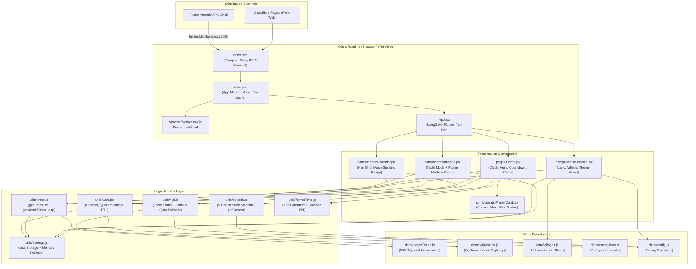
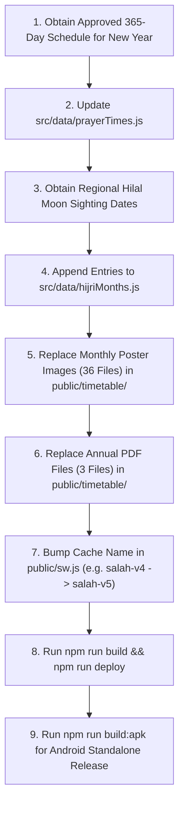

# Salah-Timing — Production Requirement Document (PRD)

> **Document Version:** 2.0 (Production Reference & Specification)  
> **Status:** Active / Production-Ready  
> **Target Release:** Q1 2026 – Q4 2026 (Operational Cycle 1447–1448 AH)  
> **Target Region:** Osmanabad District, Maharashtra, India  
> **Primary Repository:** [Osmanabad-Salah-TIme](file:///media/akai/NFORCE/Osmanabad-Salah-TIme)

---

## 1. Executive Summary & Project Overview

### 1.1 Overview
**Salah-Timing** is a specialized, zero-dependency, offline-first Progressive Web App (PWA) and standalone Android application (via Flutter WebView shell). It delivers high-precision daily Islamic prayer schedules, forbidden (*makruh*) prayer warnings, lunar Hijri calendar tracking, localized village minute offsets, and interactive monthly timetable matrices for Osmanabad (Dharashiv) district, Maharashtra, India.

The application is engineered for complete resilience under poor or non-existent connectivity, operating 100% offline after the initial visit. It provides native trilingual support across English, Hindi (हिन्दी), and Urdu (اردو) with strict Right-to-Left (RTL) typography, bidirectional Unicode isolation, and culturally appropriate color themes.

### 1.2 Strategic Goals

| ID | Objective | Success Metric | Priority |
| :--- | :--- | :--- | :--- |
| **G1** | District-Accurate Prayer Times | Deliver verified 365-day prayer times for Osmanabad city and 14 regional localities with sub-minute precision. | **Critical** |
| **G2** | Forbidden Prayer Warnings | Dynamically identify and visibly alert users during sunrise (*Tulu*), solar noon (*Zawal*), and sunset (*Ghurub*). | **Critical** |
| **G3** | Local Moon-Sighting Hijri Calendar | Display verified regional Hilal sighting dates with fallback to astronomical calculation (*Umm al-Qura*). | **High** |
| **G4** | 100% Offline Autonomy | Core scheduling, offsets, calendar conversion, and timetable table views operate without network access. | **High** |
| **G5** | Trilingual & Native RTL Parity | Instant language switching (EN/HI/UR) with zero layout shearing and correct numerical directionality. | **High** |
| **G6** | Dual-Mode Monthly Timetables | Provide both an interactive data table (with leap-year handling) and high-res printable poster images with pinch-zoom. | **Medium** |
| **G7** | Dual Packaging (PWA + Android APK) | Support standard web browser installation and provide standalone Android APK wrapper for app stores/sideloading. | **Medium** |
| **G8** | Accessible & Themeable UI | Support 4 contrast-compliant color themes (Classic, Emerald, Amber, Dark) with dynamic browser chrome syncing. | **Low** |

### 1.3 Target Audience & Personas
1. **Local Resident / Daily Practitioner:** Mobile user in Osmanabad city or nearby villages checking daily prayer windows, remaining time to next Salah, and prohibited prayer times before offering *Nafl* prayers.
2. **Mosque Committee / Imam / Mu'adhin:** Desktop or mobile user consulting the official monthly schedule, verifying village minute offsets, or downloading printable PDF timetables.
3. **Elderly & Regional Language Users:** Urdu-first or Hindi-first users requiring clear vernacular typography, intuitive icons, and an immediate first-launch language selector.

### 1.4 In-Scope vs. Out-of-Scope (Non-Goals)

| Capability | Scope Status | Architectural Rationale |
| :--- | :--- | :--- |
| **Pre-computed District Times** | **In-Scope** | Verified regional schedules eliminate GPS drift and mathematical calculation variations. |
| **15 Localities / Village Offsets** | **In-Scope** | Static minute offset mapping (-2m to +2m) ensures exact district-wide synchronization. |
| **Offline PWA + Android APK Shell** | **In-Scope** | PWA via Service Worker (`sw.js`); standalone Android APK via Flutter local HTTP server. |
| **Real-time GPS Prayer Calculation** | *Out-of-Scope* | Unnecessary battery drain and potential discrepancy with local mosque consensus. |
| **Adhan (Audio) Background Playback** | *Out-of-Scope* | OS background limits in modern mobile browsers cause unreliable audio firing. |
| **User Accounts / Cloud Synchronization** | *Out-of-Scope* | Zero user data collection; settings stay on-device in `localStorage`. |
| **Push Notifications** | *Out-of-Scope* | Avoids remote push server overhead and ensures 100% serverless static deployment. |

---

## 2. System Architecture & Tech Stack



### 2.1 Technology Stack Matrix

| Tier | Technology | Specification / Version | Purpose |
| :--- | :--- | :--- | :--- |
| **Runtime / Library** | React | `^19.3.1` | Declarative UI, state management, zero runtime overhead |
| **DOM Renderer** | React DOM | `^19.3.1` | Client mounting & React Portal for image zoom modal |
| **Iconography** | Lucide React | `^1.66.0` | Lightweight SVG icons |
| **Build Engine** | Vite | `^8.3.5` | Fast ESM HMR and tree-shaking production bundler |
| **Mobile Packaging** | Flutter & WebView | `webview_flutter ^4.10.0` | Standalone native Android APK with embedded local HTTP server |
| **Styles / Design System** | Pure CSS3 | Custom Properties (`:root`, `[data-theme]`) | Zero runtime styling, theme switching, responsive layouts |
| **Linter** | ESLint | `^10.13.0` (Flat Config) | Code quality, React hooks rules enforcement |
| **Offline Cache** | Custom Service Worker | Cache API (`salah-v4`) | Stale-while-revalidate & network-first fallback caching |
| **Hosting Platform** | Cloudflare Pages | Global Edge Network | Static SPA hosting with zero server maintenance |

### 2.2 File & Repository Organization

```text
├── .gitignore                  # Git ignore rules
├── index.html                  # HTML5 entry with PWA headers & viewport locks
├── package.json                # Project manifest, scripts, and dependencies
├── vite.config.js              # Vite configuration (relative base './' for WebView)
├── eslint.config.js            # ESLint flat config with React plugin rules
├── README.md                   # Repository overview and setup guide
├── Salah-Timing.md             # This Production Requirement Document
├── flutter_app/                # Flutter native Android wrapper project
│   ├── pubspec.yaml            # Flutter dependencies (webview_flutter, shelf)
│   ├── lib/main.dart           # Local HTTP file server + WebView shell
│   └── android/                # Android native gradle project & manifest
├── public/
│   ├── sw.js                   # Service Worker (Cache version 'salah-v4')
│   ├── manifest.json           # Web App Manifest for PWA installation
│   ├── icons/                  # 192px, 512px, maskable & apple-touch icons
│   └── timetable/
│       ├── en/ hi/ ur/         # High-res monthly timetable posters (1–12.jpg)
│       └── namaz-waqt-{en,hi,ur}.pdf # Downloadable full-year timetable PDFs
└── src/
    ├── main.jsx                # Application root, DOM bootstrap, asset pre-cache
    ├── App.jsx                 # App shell, language gate, popstate tab router
    ├── index.css               # Complete stylesheet, CSS variables, 4 color themes
    ├── pages/
    │   └── Home.jsx            # Real-time dashboard, clock, next prayer, cards
    ├── components/
    │   ├── PrayerCard.jsx      # Individual prayer card component
    │   ├── Images.jsx          # Timetable view (Table mode + Poster mode + Modal)
    │   ├── Calendar.jsx        # Dual Hijri-Gregorian monthly grid
    │   └── Settings.jsx        # Localization, village selector, theme picker, about
    ├── utils/
    │   ├── times.js            # Village minute offset and leap-year calculations
    │   ├── periods.js          # 9-period state machine & prohibited time rules
    │   ├── hijri.js            # Local Hilal sighting resolver with Intl fallback
    │   ├── i18n.jsx            # Localization context, t() function, RTL engine
    │   ├── formatTime.js       # 24h to 12h conversion with Unicode bidi isolation
    │   ├── toMinutes.js        # "HH:MM" string to minutes-from-midnight integer
    │   └── settings.js         # Safe localStorage access with in-memory fallback
    └── data/
        ├── prayerTimes.js      # 365-day schedule matrix for Osmanabad
        ├── hijriMonths.js      # Verified local moon-sighting Hijri month boundaries
        ├── villages.js         # 15 district villages with minute offsets
        ├── translations.js     # Trilingual translation dictionary (86 keys x 3)
        └── config.js           # Calculation constants and toggle flags
```

---

## 3. Functional Requirements Specification

### 3.1 First-Launch Experience & Localization Gate

#### [FR-00] First-Launch Language Selector
- **Condition:** On initial application launch, if `localStorage.getItem("lang")` is absent or empty string `""`, the application MUST intercept rendering and display the full-screen Language Gate.
- **UI Elements:**
  - App heading: `"Osmanabad Salah Time"`
  - Trilingual subtitle: `"Choose your language · भाषा चुनें · زبان منتخب کریں"`
  - Three touch-optimized buttons (minimum height 48px): **English**, **हिन्दी**, **اردو**.
- **State Action:** Selecting a language MUST invoke `saveLang(code)`, update `i18n` context, apply HTML attributes (`lang="{code}"`, `dir="rtl"` for Urdu, `dir="ltr"` for English/Hindi), and transition immediately to the primary App Shell without page reload.
- **Subsequent Visits:** The screen is bypassed completely on all future visits unless the user clears site data.

---

### 3.2 Home Screen — Real-Time Prayer Dashboard

#### [FR-01] Precision Digital Clock
- **Display:** Display current civil time in 12-hour format (`h:mm A` / `h:mm PM`).
- **Tick Interval:** Driven by `setInterval` ticking precisely once every 1,000 ms.
- **Bidirectional Unicode Isolation:** Time values MUST be wrapped with Unicode bidi isolate characters (`\u2066` and `\u2069`) via [`formatTime.js`](file:///media/akai/NFORCE/Osmanabad-Salah-TIme/src/utils/formatTime.js) so that numbers and AM/PM tokens remain strictly Left-to-Right even when rendered inside an Urdu RTL context.

#### [FR-02] 6-Slot Prayer Time Schedule
- **Schedule Rows:** For the active selected date, display the 6 standard timings:
  1. **Fajr** (True Dawn)
  2. **Sunrise** (*Tulu-e-Aftab* / End of Fajr)
  3. **Zuhr** (Midday / Friday congregational *Jumuah*)
  4. **Asr** (Afternoon prayer)
  5. **Maghrib** (Sunset prayer)
  6. **Isha** (Night prayer)
- **Friday Jumuah Overwrite:** When the selected date is a Friday (`date.getDay() === 5`), the Zuhr label MUST automatically switch to **Jumuah (Zuhr)** using the `jumuah` translation key.
- **Card States & Styling:**
  - **`current`**: Background set to primary theme gradient, white text, displays translated `"Current"` badge.
  - **`next`**: Accent border / highlighted container, displays translated `"Upcoming"` badge.
  - **`past`**: Card opacity reduced to `0.6` (and icon container to `0.7`) to deemphasize passed prayer periods.

#### [FR-03] Dynamic Status Pill & Prohibited Time Alerts
- **Hero Card Status Pill:** Renders a badge in the hero banner reflecting the currently active prayer window or prohibited state.
- **Danger Periods (Makruh Times):**
  - During prohibited prayer windows (**Sunrise**, **Zawal**, **Sunset**), the status pill MUST adopt the `.danger` class (red background `#C0392B`), display the `AlertTriangle` warning icon, and trigger an active CSS pulsing animation (`@keyframes alertPulse`).
- **Informational Period (Ishraq/Chasht):**
  - Between Sunrise + 20m and Zawal start, an informational status pill indicates the permitted Ishraq/Chasht period.

#### [FR-04] Countdown Timer & Midnight Rollover
- **Countdown Computation:** Calculates the exact minutes remaining until the next upcoming prayer milestone.
- **Format:** Displayed using the localized template string `t("duration", { h, m })` (e.g., `"2h 15m"`).
- **Post-Isha Transition:** If the current time is past Isha, the countdown targets **Fajr (Tomorrow)**:
  $$\Delta t = (1440 - t_{\text{now}}) + t_{\text{fajr tomorrow}}$$
  The countdown header switches to `t("fajrTomorrow")`.

#### [FR-05] Date Navigation & Hero Village Shortcut
- **Day Selector:** Left and right chevron buttons allow inspecting past or future prayer dates.
- **RTL Chevron Inversion:** In Urdu RTL mode, chevron icons MUST swap direction so that logical "forward in time" aligns with natural reading order.
- **Date Picker Input:** Hidden native `<input type="date">` accessible by tapping the date header for rapid jumping.
- **Relative Day Badges:** Highlights `"Today"`, `"Yesterday"`, or `"Tomorrow"`. If viewing any non-today date, a `"Back to Today"` shortcut button MUST appear.
- **Hero Village Pill Button:** The hero card displays an interactive locality badge (e.g., `📍 Umarga -2m`). Clicking this button MUST programmatically trigger a `popstate` navigation event directly to the **Settings** tab.

#### [FR-06] Prohibited (Makruh) Prayer Window Rules

| Interval | Start Condition | End Condition | Duration | Warning Text Key |
| :--- | :--- | :--- | :--- | :--- |
| **Sunrise (*Tulu*)** | Exact Sunrise time | Sunrise + `SUNRISE_MINUTES` | 20 minutes | `sunriseNote` |
| **Zawal (*Nisf al-Nahar*)** | Zuhr − `ZAWAL_BY_MONTH[month]` | Exact Zuhr start time | 5 minutes | `zawalNote` (interpolates `{zuhr}`) |
| **Sunset (*Ghurub*)** | Maghrib − `SUNSET_MINUTES` | Exact Maghrib start time | 10 minutes | `sunsetNote` |

- **Jurisprudential Logic:** During these 3 intervals, offering any *Fard* or *Nafl* prayer is impermissible (*Makruh Tahrimi*). The app highlights the warning note banner in red.
- **Friday Note:** A special reminder note (`fridayNote`) is appended to the hero section on Fridays.

#### [FR-07] Village & Locality Minute Offset Engine
- **Offset Bounds:** Supports 15 localities across Osmanabad district with offsets ranging from **-2 to +2 minutes**.
- **Application:** Offsets are added to all 6 schedule times via modular 1440-minute arithmetic.
- **Offset Notice:** If no village has been explicitly selected, the home dashboard and timetable display a prominent notice (`villageNotice`) recommending users verify their village offset.

---

### 3.3 Timetable Screen — Dual-Mode Monthly Schedule

#### [FR-08] Dual-Mode View Switcher (Table View vs. Poster View)
- **Top Toggle Control:** A segmented control allows switching between:
  1. **Table View (`tableView`)**: Fast, lightweight HTML data table of the month's daily prayer times.
  2. **Poster View (`posterView`)**: High-resolution image card showing the printed wall-timetable design.
- **Persistence:** The chosen view mode stays active across month switches.

#### [FR-09] Interactive Monthly Table View
- **Data Rendering:** Renders a full-width HTML `<table>` for all days in the selected month (28, 29, 30, or 31 rows).
- **Columns:** Date (`date`), Fajr (`fajr`), Sunrise (`sunriseShort`), Zuhr (`zuhr`), Asr (`asr`), Maghrib (`maghrib`), Isha (`isha`).
- **Locality Offsets Applied:** All times in the table reflect the selected village's minute offsets in real time.
- **Auto-Scroll to Today:** On initial render of the current month, the table viewport automatically scrolls vertically to bring today's row (`.tt-row-today`) into view.
- **Leap Year February 29 Rule:** In leap years, February table view automatically generates day 29 by replicating day 28 values, matching regional Islamic calendar convention.
- **Table Footer Hint:** Displays a permanent AM/PM key: Fajr/Sunrise in AM; Zuhr/Asr/Maghrib/Isha in PM.

#### [FR-10] Poster Image Timetable & Predictive Preloading
- **Image Source:** Loaded from `/timetable/{lang}/{month}.jpg` (36 high-resolution assets).
- **Locality Banner:** Displays the active village name and minute offset above the poster card.
- **Predictive Pre-caching:** When viewing month $m$, the app initiates silent background preloading of adjacent months ($m-1$ and $m+1$).

#### [FR-11] Full-Screen Modal Image Viewer with Pan & Zoom
- **Portal Rendering:** Tapping the poster image opens a full-screen modal rendered via `ReactDOM.createPortal` directly into `document.body`.
- **Zoom Gestures:**
  - **Pinch-to-Zoom:** Two-finger touch gesture tracking distance delta, zooming smoothly from 1.0x up to 4.0x.
  - **Mouse Wheel Zoom:** Desktop wheel scrolling zooms in and out around pointer position.
  - **On-Screen Controls:** Floating `+` and `−` buttons with zoom level readout (e.g., `2.5x`).
- **Drag-to-Pan:** When zoom level $> 1.0\text{x}$, single pointer dragging allows panning across the image with strict bounding constraints to prevent panning out of view.
- **Dismissal & Back-Button Sync:** Modal can be closed via the `✕` close button or by pressing the hardware/browser Back button (intercepted via History API `pushState` / `popstate`).

#### [FR-12] Print-Ready Annual PDF Timetables
- **Download Action:** Direct download button linking to `/timetable/namaz-waqt-{lang}.pdf`.
- **Locales:** English (`en`), Hindi (`hi`), and Urdu (`ur`) full-year vector/raster print files.

---

### 3.4 Hijri Calendar Screen

#### [FR-13] Hijri-Centric Monthly Grid
- **Lunar Month Grid:** Renders a 7-column calendar grid (Sunday through Saturday) representing a complete Hijri month (29 or 30 days).
- **Dual Day Indicators:**
  - **Primary:** Bold Hijri day number ($1$ to $29/30$).
  - **Secondary:** Subdued Gregorian civil day number ($1$ to $31$).
- **Weekday Localization:** Column headers populated via translation keys `wd0` through `wd6`.
- **Today Highlight:** Current calendar date is marked with `.cal-cell.today` in the primary theme color.

#### [FR-14] Regional Moon Sighting vs. Astronomical Fallback
- **Confirmed Moon Sightings:** Sourced from [`src/data/hijriMonths.js`](file:///media/akai/NFORCE/Osmanabad-Salah-TIme/src/data/hijriMonths.js) containing verified Hilal sighting dates for Maharashtra/Osmanabad region.
- **Astronomical Estimation:** When navigating to dates beyond verified data, the calendar falls back to `Intl.DateTimeFormat("en-US", { calendar: "islamic-umalqura" })` calibrated with `HIJRI_SHIFT = -1`.
- **Estimated Badge:** If any day cell in the active month view relies on calculated data, an informative disclaimer (`hijriEstimate`) is displayed.

---

### 3.5 Settings Screen

#### [FR-15] Trilingual Language Switcher
- Segmented control toggling between **English**, **हिन्दी**, and **اردو**.
- Immediate execution: updates `<html>` attributes (`dir` and `lang`), persists to `localStorage`, and translates all open views without reloading.

#### [FR-16] Locality / Village Selector
- Native `<select>` dropdown enumerating all 15 supported localities.
- Dynamically shows localized locality names based on the active language.
- Explanatory subtitle indicates offset relationship to Osmanabad city center:
  - `sameAsCity`: `"Same time as Osmanabad city"`
  - `earlier`: `"{n} minute(s) earlier"`
  - `later`: `"{n} minute(s) later"`
- Selection persisted under `localStorage` key `"village"`.

#### [FR-17] Theme Engine & Browser Chrome Synchronization
- 4 color palettes presented in a 2x2 grid with color preview swatches:

| Theme ID | Name | Accent / Primary | Surface Color | Meta Theme-Color |
| :--- | :--- | :--- | :--- | :--- |
| `light` | Classic | `#547FA5` (Steel Blue) | `#FFFFFF` | `#547FA5` |
| `emerald` | Emerald | `#1E7E55` (Islamic Green) | `#FFFFFF` | `#1E7E55` |
| `amber` | Amber | `#9E6C20` (Warm Gold) | `#FFFFFF` | `#9E6C20` |
| `dark` | Dark | `#6FA3CF` (Sky Accent) | `#172636` | `#0F1B27` |

- **Application:** Applies `data-theme="{id}"` on `document.documentElement` and synchronously updates `<meta name="theme-color">` to colorize the mobile browser status bar.

#### [FR-18] About & Distribution Credits
- **District Scope Notice:** Displays `districtOnly` disclaimer ("These timings are verified for Osmanabad district only").
- **Scholarly Credit Flag:** Configurable credit line controlled via `SHOW_CREDIT` constant in [`config.js`](file:///media/akai/NFORCE/Osmanabad-Salah-TIme/src/data/config.js).
- **Installation Instructions:** Explains PWA Add to Home Screen process (`installNote`).
- **Auto-Save Confirmation:** Informs users that preferences are saved automatically on device (`savedNote`).

---

### 3.6 Application Shell & Navigation

#### [FR-19] History API Tab Navigation
- **4 Primary Tabs:** **Home** (`HomeIcon`), **Timetable** (`BookOpen`), **Calendar** (`CalendarDays`), **Settings** (`SettingsIcon`).
- **History Stack Handling:**
  - Home to Tab: `history.pushState({ tab: id }, "")`
  - Tab to Tab: `history.replaceState({ tab: id }, "")`
  - Tab to Home: `history.back()`
- **Hardware Back Button:** Listens for `window.addEventListener("popstate")` ensuring the Android system back gesture smoothly navigates back to Home rather than exiting the application.

#### [FR-20] Native Android APK Wrapper (Flutter Shell)
- **Local Embedded Server:** Uses Flutter's internal `HttpServer` binding to `127.0.0.1` serving bundled assets from `flutter_app/assets/dist/`.
- **WebView Container:** Powered by `webview_flutter` loading `http://127.0.0.1:{port}/index.html`.
- **System Chrome Customization:** Sets Android status bar color to `#547FA5` with light icons.
- **Build Pipeline:** Automated via `npm run build:apk` which builds Vite assets, copies them to the Flutter asset directory, and invokes `flutter build apk --release`.

---

## 4. Data Specifications & Localization Registry

### 4.1 365-Day Prayer Times Matrix (`prayerTimes.js`)

The master calendar stores 365 pre-calculated daily records for Osmanabad city center ($18.1856^\circ\text{ N}, 76.0416^\circ\text{ E}$):

```javascript
// Data Structure: Object indexed by month (1-12) containing arrays of 6-tuples
export const prayerTimes = {
  1: [ // January (31 days)
    ["05:42", "06:58", "12:35", "15:47", "18:09", "19:25"], // Jan 1: [Fajr, Sunrise, Zuhr, Asr, Maghrib, Isha]
    // ... 31 entries
  ],
  2: [ /* 28 entries */ ],
  // ... Months 3 through 12
};
```

### 4.2 Localities & District Minute Offsets (`villages.js`)

All 15 localities are mapped with multi-lingual names and fixed minute deltas relative to Osmanabad city:

| Locality ID | English Name | Hindi Name (`hi`) | Urdu Name (`ur`) | Offset ($\Delta m$) |
| :--- | :--- | :--- | :--- | :--- |
| `osmanabad` | Osmanabad | उस्मानाबाद | عثمان آباد | **0** |
| `umarga` | Umarga | उमरगा | عمرگا | **-2** |
| `dalimb` | Dalimb | डालिंब | ڈالمب | **-2** |
| `murum` | Murum | मुरूम | مروم | **-2** |
| `naldurg` | Naldurg | नलदुर्ग | نلدرگ | **-1** |
| `itkal` | Itkal | इटकल | اٹکل | **-1** |
| `masla` | Masla | मसला | مسلہ | **-1** |
| `karjkheda` | Karjkheda | करजखेडा | کرجکھیڑا | **-1** |
| `lohara` | Lohara | लोहारा | لوہارہ | **-1** |
| `shiradhon` | Shiradhon | शिराढोण | شیراڈھون | **+1** |
| `kalamb` | Kalamb | कलंब | کلمب | **+1** |
| `terkheda` | Terkheda | तेरखेडा | ترکھیڑا | **+1** |
| `washi` | Washi | वाशी | واشی | **+1** |
| `bhum` | Bhum | भूम | بھوم | **+2** |
| `paranda` | Paranda | परंडा | پرنڈا | **+2** |

### 4.3 Confirmed Hilal Moon Sighting Table (`hijriMonths.js`)

Verified crescent sighting records for Hijri years 1447 and 1448 AH:

| Hijri Year | Hijri Month | Month Name | Gregorian Start Date | Status |
| :--- | :--- | :--- | :--- | :--- |
| 1447 | 8 | Shaban | `2026-01-21` | Confirmed Sight |
| 1447 | 9 | Ramadan | `2026-02-19` | Confirmed Sight |
| 1447 | 10 | Shawwal | `2026-03-21` | Confirmed Sight |
| 1447 | 11 | Dhul Qadah | `2026-04-19` | Confirmed Sight |
| 1447 | 12 | Dhul Hijjah | `2026-05-19` | Confirmed Sight |
| 1448 | 1 | Muharram | `2026-06-17` | Confirmed Sight |
| 1448 | 2 | Safar | `2026-07-17` | Confirmed Sight |
| 1448 | 3 | Rabi I | `2026-08-15` | Confirmed Sight |
| 1448 | 4 | Rabi II | `2026-09-14` | Confirmed Sight |
| 1448 | 5 | Jumada I | `2026-10-13` | Confirmed Sight |
| 1448 | 6 | Jumada II | `2026-11-12` | Confirmed Sight |
| 1448 | 7 | Rajab | `2026-12-11` | Confirmed Sight |

### 4.4 Tunable System Parameters (`config.js`)

| Constant Identifier | Value | Operational Definition |
| :--- | :--- | :--- |
| `SUNRISE_MINUTES` | `20` | Interval in minutes following Sunrise during which prayer remains strictly forbidden. |
| `ZAWAL_BY_MONTH` | `[5, 5, 5, 5, 5, 5, 5, 5, 5, 5, 5, 5]` | Minutes prior to Zuhr during which the sun is at meridian (*Nisf al-Nahar*). |
| `SUNSET_MINUTES` | `10` | Minutes prior to Maghrib during which prayers are prohibited (*Ghurub*). |
| `HIJRI_SHIFT` | `-1` | Day offset calibration applied to `Intl` Umm al-Qura fallback calculation. |
| `SHOW_CREDIT` | `false` | Boolean toggle controlling whether donor/author credit displays in Settings. |

### 4.5 Complete Trilingual Translation Registry (86 Keys per Locale)

The application maintains 86 verified keys across `en`, `hi`, and `ur`:

| Category | Keys |
| :--- | :--- |
| **Navigation & Tabs** | `home`, `timetable`, `calendar`, `settings` |
| **Timetable Views** | `tableView`, `posterView`, `date`, `sunriseShort`, `tapToZoom`, `downloadPdf` |
| **Prayer Names** | `fajr`, `sunrise`, `zuhr`, `asr`, `maghrib`, `isha`, `jumuah` |
| **Special Intervals** | `ishraq`, `zawal`, `sunset`, `maghribAwwabin`, `ishaTahajjud` |
| **Interval Explanations** | `sunriseNote`, `ishraqNote`, `zawalNote` (interpolates `{zuhr}`), `sunsetNote`, `fridayNote` |
| **Card Status & Timers**| `current`, `upcoming`, `fajrTomorrow`, `duration` (interpolates `{h}`, `{m}`) |
| **Relative Days** | `yesterday`, `today`, `tomorrow` |
| **Locality / Offsets** | `yourVillage`, `selectVillage`, `noVillage`, `sameAsCity`, `earlier` (`{n}`), `later` (`{n}`), `villageNotice` |
| **Theme Engine** | `theme`, `light`, `dark`, `themeClassic`, `themeEmerald`, `themeAmber`, `themeDark` |
| **Gregorian Months** | `m1`, `m2`, `m3`, `m4`, `m5`, `m6`, `m7`, `m8`, `m9`, `m10`, `m11`, `m12` |
| **Weekdays (Sun–Sat)** | `wd0`, `wd1`, `wd2`, `wd3`, `wd4`, `wd5`, `wd6` |
| **Hijri Months (1–12)** | `hm1`, `hm2`, `hm3`, `hm4`, `hm5`, `hm6`, `hm7`, `hm8`, `hm9`, `hm10`, `hm11`, `hm12` |
| **Disclaimers & Notes** | `language`, `districtOnly`, `savedNote`, `about`, `credit`, `installNote`, `hijriEstimate` |

---

## 5. Algorithmic Specifications & Mathematical Boundaries

### 5.1 Modular Minute Arithmetic (`times.js`)
Prayer times are stored as 24-hour strings (`"HH:MM"`). Applying village minute offset $\Delta \in [-2, +2]$ follows strict modulo-1440 circular time arithmetic:

$$\text{minutes}_{\text{raw}} = (h \times 60) + m$$

$$\text{minutes}_{\text{shifted}} = ((\text{minutes}_{\text{raw}} + \Delta) \pmod{1440} + 1440) \pmod{1440}$$

$$h_{\text{out}} = \lfloor \text{minutes}_{\text{shifted}} / 60 \rfloor, \quad m_{\text{out}} = \text{minutes}_{\text{shifted}} \pmod{60}$$

### 5.2 9-Period Chronological State Machine (`periods.js`)
A solar day is partitioned into 9 ordered intervals:

```text
[00:00] ---- Isha / Tahajjud (Carried over from yesterday) ----> [Fajr Start]
  (1) Fajr:                [Fajr Start]                 --> [Sunrise]
  (2) Sunrise (Makruh):    [Sunrise]                    --> [Sunrise + 20m]
  (3) Ishraq / Chasht:     [Sunrise + 20m]              --> [Zuhr - Zawal]
  (4) Zawal (Makruh):      [Zuhr - 5m]                  --> [Zuhr Start]
  (5) Zuhr / Jumuah:       [Zuhr Start]                 --> [Asr Start]
  (6) Asr:                 [Asr Start]                  --> [Maghrib - 10m]
  (7) Sunset (Makruh):     [Maghrib - 10m]              --> [Maghrib Start]
  (8) Maghrib / Awwabin:   [Maghrib Start]              --> [Isha Start]
  (9) Isha / Tahajjud:     [Isha Start]                 --> [23:59:59]
```

#### Pre-Dawn Boundary Resolution
Between `00:00` and the morning `Fajr` start, no period has $\text{start} \le t_{\text{now}}$ within the current calendar day. [`getCurrent()`](file:///media/akai/NFORCE/Osmanabad-Salah-TIme/src/utils/periods.js) handles this boundary condition:
```javascript
export function getCurrent(periods, nowMinutes) {
    const found = periods.findLast ? periods.findLast((p) => p.start <= nowMinutes) 
                                   : [...periods].reverse().find((p) => p.start <= nowMinutes);
    // Boundary fallback: pre-dawn times belong to Isha / Tahajjud period
    return found || periods[periods.length - 1];
}
```

### 5.3 Hybrid Hijri Date Engine (`hijri.js`)
Given a target Gregorian Date:
1. Compute epoch day number: $D_{\text{target}} = \lfloor \text{Date.UTC}(y, m, d) / 86400000 \rfloor$.
2. Search confirmed sightings array $\mathcal{S}$ in descending order for the latest entry where $D_{\text{sighting}} \le D_{\text{target}}$.
3. If $D_{\text{target}}$ is within known range:
   $$\text{Hijri Day} = (D_{\text{target}} - D_{\text{sighting}}) + 1, \quad \text{Estimated} = \text{false}$$
4. If beyond verified sightings:
   - Shift date by `HIJRI_SHIFT` ($-1$ day).
   - Format using browser `Intl.DateTimeFormat("en-US", { calendar: "islamic-umalqura" })`.
   - Extract parts and return with `estimated: true`.

---

## 6. Offline Architecture & Service Worker Specification

### 6.1 Service Worker Lifecycle (`sw.js`)
- **Cache Name:** `salah-v4`
- **Activation:** `skipWaiting()` called during `install`; `clients.claim()` called during `activate`.
- **Cache Invalidation:** The `activate` handler iterates over all cache keys in `caches.keys()` and immediately purges any cache name $\ne \text{"salah-v4"}$.

### 6.2 Dual-Tier Caching Matrix

| Request Category | Intercept Filter | Strategy | Fail-Safe Mechanism |
| :--- | :--- | :--- | :--- |
| **Navigation Requests** | `req.mode === "navigate"` | **Network-First** (2,500ms timeout) | If network takes $> 2.5\text{s}$ or throws, serves cached HTML or root fallback (`"/"`). |
| **Static Assets** | JS, CSS, PNG, JPG, PDF | **Stale-While-Revalidate** | Serves cached asset instantaneously; simultaneously fetches fresh copy from network to update cache. |

### 6.3 Predictive Asset Pre-Caching (`main.jsx`)
Upon page load, the client identifies all active runtime assets and dispatches an asynchronous `postMessage` to `sw.js`:
```javascript
ready.active?.postMessage({
  type: "CACHE_URLS",
  urls: [
    location.origin + "/",
    ...performance.getEntriesByType("resource").map(r => r.name),
    `${location.origin}/timetable/${lang}/${currentMonth}.jpg`,
    `${location.origin}/timetable/${lang}/${nextMonth}.jpg`
  ]
});
```

---

## 7. Non-Functional Requirements & Production Standards

### 7.1 Performance Budgets & Core Web Vitals Targets

| Metric | Target Threshold | Measured / Expected | Enforcement Method |
| :--- | :--- | :--- | :--- |
| **Total JavaScript (Gzip)** | $< 90\text{ KB}$ | $\approx 64\text{ KB}$ | Vite rollup chunking analysis |
| **Total CSS (Gzip)** | $< 5\text{ KB}$ | $\approx 3.8\text{ KB}$ | Single bundled stylesheet |
| **Largest Contentful Paint (LCP)** | $< 1.2\text{ s}$ | $0.8\text{ s}$ on 4G | Zero web fonts; pre-rendered DOM |
| **Cumulative Layout Shift (CLS)** | $\mathbf{0.000}$ | $0.000$ | Fixed dimensions & CSS grid reservations |
| **Interaction to Next Paint (INP)** | $< 50\text{ ms}$ | $< 16\text{ ms}$ | Synchronous lightweight React state updates |
| **First Contentful Paint (FCP)** | $< 1.0\text{ s}$ | $0.5\text{ s}$ | Cached SPA shell |

### 7.2 Security & Data Privacy Architecture
- **Zero Telemetry & Tracking:** No third-party trackers, analytics scripts (Google Analytics, Mixpanel), or external CDNs are loaded.
- **Local Storage Hardening:** All user preferences (`lang`, `village`, `theme`) remain strictly on the user's device. No PII is collected or transmitted.
- **Fail-Safe Storage Fallback:** If `localStorage` access is blocked (e.g., Safari Private Browsing quota exceeded), the app seamlessly degrades to an internal volatile `Map()` in [`settings.js`](file:///media/akai/NFORCE/Osmanabad-Salah-TIme/src/utils/settings.js).
- **Recommended Content Security Policy (CSP):**
  ```http
  Content-Security-Policy: default-src 'self'; script-src 'self'; style-src 'self' 'unsafe-inline'; img-src 'self' data:; connect-src 'self';
  ```

### 7.3 Accessibility & Internationalization (WCAG 2.1 AA)
- **Minimum Touch Targets:** All interactive buttons, chips, and selectors maintain bounding boxes $\ge 44 \times 44\text{ px}$.
- **Contrast Ratios:** Text colors across all 4 themes achieve WCAG AA contrast ratio $\ge 4.5:1$ against their respective surface backgrounds.
- **Bidirectional Isolation:** All dynamic timestamps enforce Unicode bidi isolation via `\u2066` and `\u2069` escapes.
- **Font Stack:** Uses native platform typography (`system-ui, -apple-system, sans-serif`) to ensure zero layout shift and flawless rendering of Devanagari and Urdu Naskh/Nastaliq glyphs.

---

## 8. Quality Assurance & Testing Matrix

### 8.1 Automated Test Suites (Recommended Vitest Suite)

| Test Module | Coverage Scope | Critical Test Scenarios |
| :--- | :--- | :--- |
| **`times.test.js`** | Offset calculations | Normal offsets, midnight boundary wrap (e.g., `00:01` with $-2\text{m} \to 23:59$), leap year day 29 duplicate. |
| **`periods.test.js`**| State machine | Exact period start timestamps, pre-dawn Isha fallback, Friday Zuhr $\to$ Jumuah rename. |
| **`hijri.test.js`**  | Calendar engine | Confirmed moon sighting lookup, transition day boundary, Umm al-Qura fallback math. |
| **`formatTime.test.js`**| Bidi output | Verification of isolate delimiters `\u2066` and `\u2069` on 12-hour formatted strings. |

### 8.2 Device & Browser Verification Matrix

| Platform | Environments Tested | Verification Status |
| :--- | :--- | :--- |
| **Android Mobile** | Chrome 120+, Samsung Internet 23+, Firefox Mobile | Verified / PWA Compliant |
| **Android APK** | Android 10, 11, 12, 13, 14 (Flutter WebView) | Verified / Standalone Compliant |
| **iOS / iPadOS** | Safari 16+, Chrome iOS | Verified / PWA Add to Home Screen |
| **Desktop Web** | Chrome, Edge, Firefox, Safari (macOS/Windows/Linux) | Verified / Centered Responsive View |

---

## 9. Operations, Release & Annual Rollover Playbook

### 9.1 Annual Data Rollover Checklist (Target: Every December)



### 9.2 Adding a New Village / Locality
To add a new locality to Osmanabad district:
1. Open [`src/data/villages.js`](file:///media/akai/NFORCE/Osmanabad-Salah-TIme/src/data/villages.js).
2. Append a record with unique `id`, default `name`, Hindi name `hi`, Urdu name `ur`, and minute `offset` ($-2$ to $+2$).
3. The Settings dropdown, home village banner, and timetable offset calculations pick up the new entry automatically with zero additional code modifications.

---

## 10. Risk Register & Mitigation Strategy

| Risk ID | Risk Description | Severity | Probability | Mitigation Strategy |
| :--- | :--- | :--- | :--- | :--- |
| **R1** | **Hilal Moon Sighting Discrepancy:** Actual local crescent sighting differs from Umm al-Qura astronomical projection. | Medium | High | Verified local sighting table [`hijriMonths.js`](file:///media/akai/NFORCE/Osmanabad-Salah-TIme/src/data/hijriMonths.js) takes precedence; dates relying on algorithmic fallback are explicitly badged as "Estimated". |
| **R2** | **Stale Cache on Client Devices:** Users retain older service worker cache after annual data updates. | High | Medium | Bumping the cache constant in `public/sw.js` forces the `activate` event to delete all old caches and claim existing clients immediately. |
| **R3** | **Storage Quota Exceeded / Private Mode:** Safari private browsing throws error on `localStorage.setItem`. | Medium | Low | [`settings.js`](file:///media/akai/NFORCE/Osmanabad-Salah-TIme/src/utils/settings.js) wraps all access in `try/catch` with a seamless in-memory fallback. |
| **R4** | **Missing Browser `Intl` Calendar Support:** Legacy browser lacking `islamic-umalqura` calendar identifier. | Low | Low | Calendar component safely recovers and displays Gregorian date range; core prayer times remain unaffected as they are pre-calculated. |

---

## 11. Document History & Revision Log

| Revision | Date | Author / Role | Changes Summary |
| :--- | :--- | :--- | :--- |
| **1.0** | 2026-11-09 | Engineering Team | Initial reference architecture and baseline specification. |
| **2.0** | 2026-11-11 | Staff Systems Architect | Complete production PRD overhaul: added Table View mode specifications, Flutter Android APK wrapper architecture, 86-key translation registry, leap-year calculations, pre-dawn state machine boundary resolution, WCAG 2.1 AA benchmarks, testing strategy, and annual rollover playbook. |

